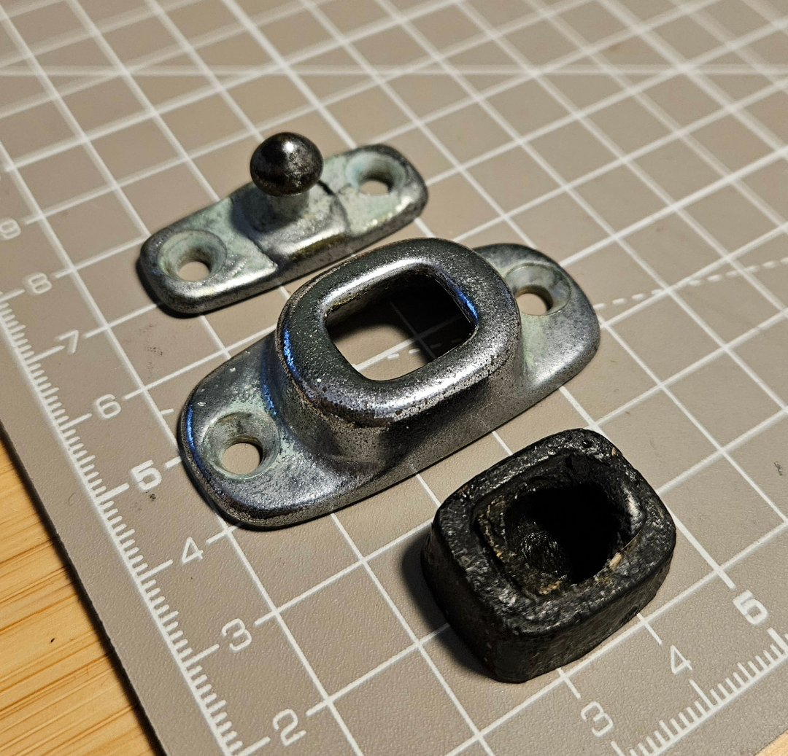
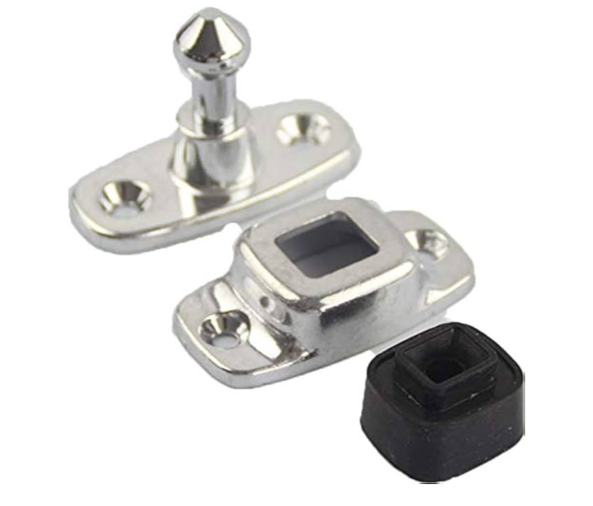
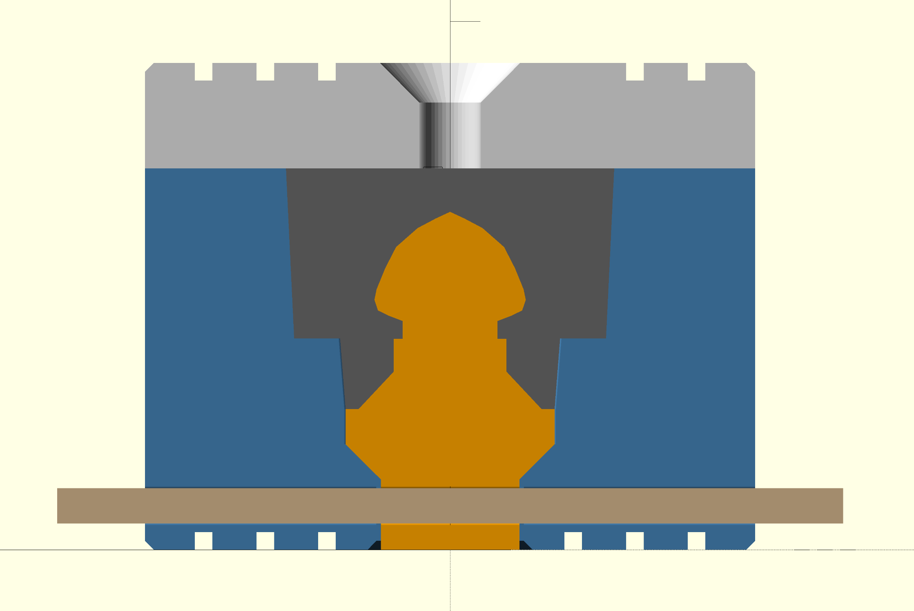
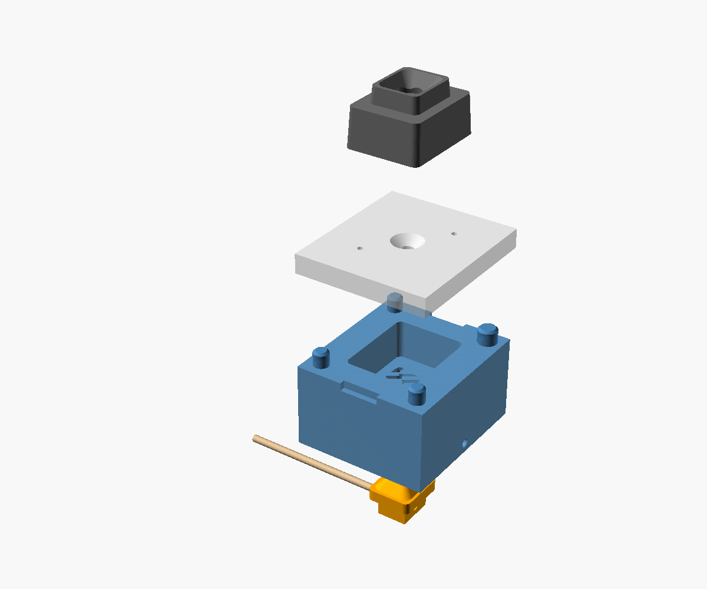
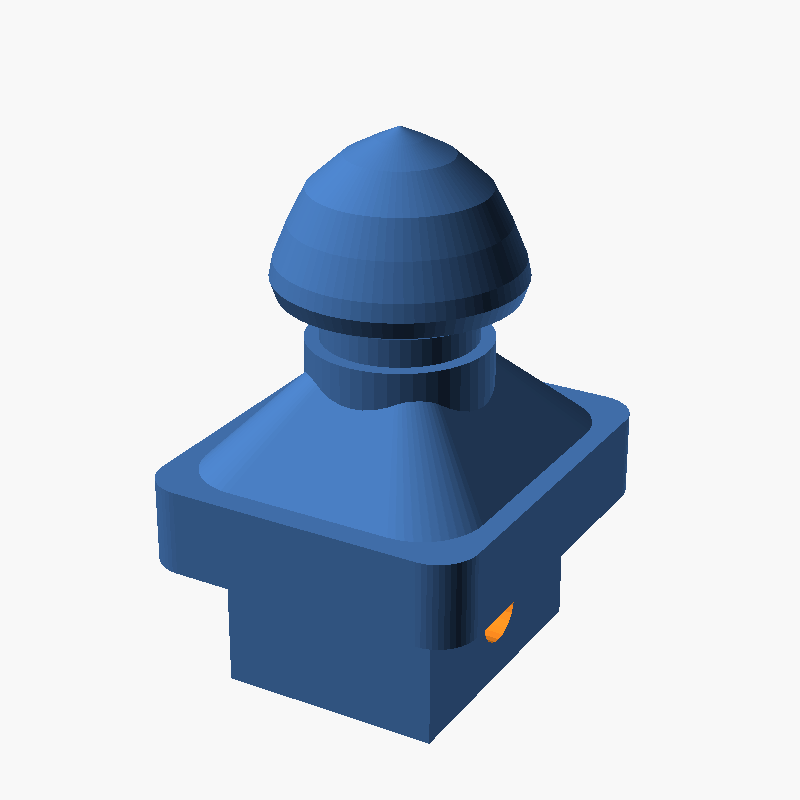

# Door Catch

My Boat has these door catches, made of nice 1970's solid feeling metal. But also sadly 1970's era rubber inserts.

The rubber has long-since perished, and new parts are either badly made, hard to come by, or expensive. Often a combination.

This is my attempt at modelling a mould for casting my own replacement rubber parts

## Mould

Currently just a single mould for me to experiment with and dial in the parameters. I intend on making a 4-cavity mould for small-scale production.

## Printer

I picked up an old [Anycubic Photon Mono 2](https://wiki.anycubic.com/en/resin-3d-printer/photon-mono-2) off FB Marketplace for £30 since it apparently had a broken screen.

Turned out the screen was fine! But the glass behind it was missing. £0.60 later I got a replacement 155x97mm 3mm thick clear float glass from the local glazier and it's all working.

Currently experimenting with standard grey resin.

## Rubber

I've initially going to try [Polytek Poly PT Flex 60 Liquid Casting Rubber](https://www.mbfg.co.uk/pt-flex-60-rubber.html) with [Polytek Polycolor Polyurethane Black Dye](https://www.mbfg.co.uk/polytek_pigment.html) for the look and hopefully a bit of UV protection :crossed_fingers:

## Licence

This project is licensed under a
[Creative Commons Attribution 4.0 International Licence](https://creativecommons.org/licenses/by/4.0/) by Nick Palmer.

You are free to share and adapt the design, including commercially, as long as you give appropriate credit.
